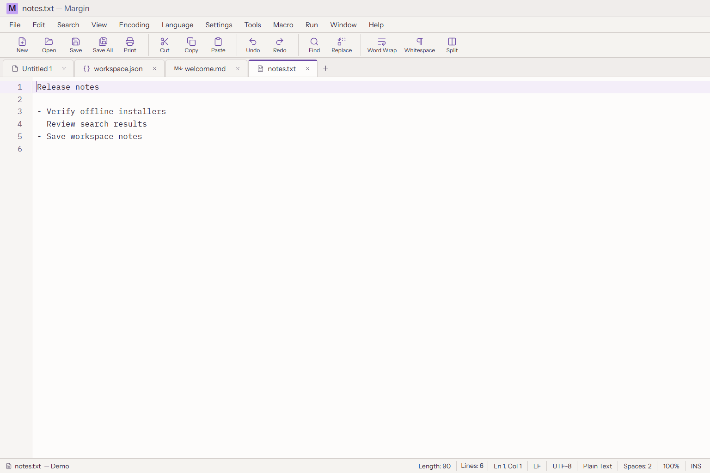
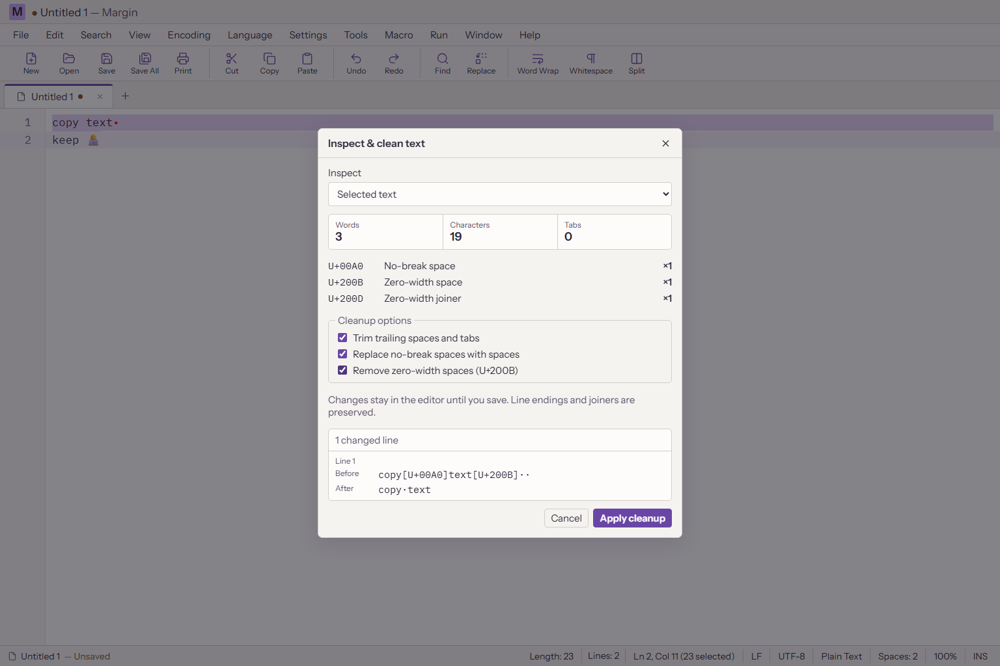
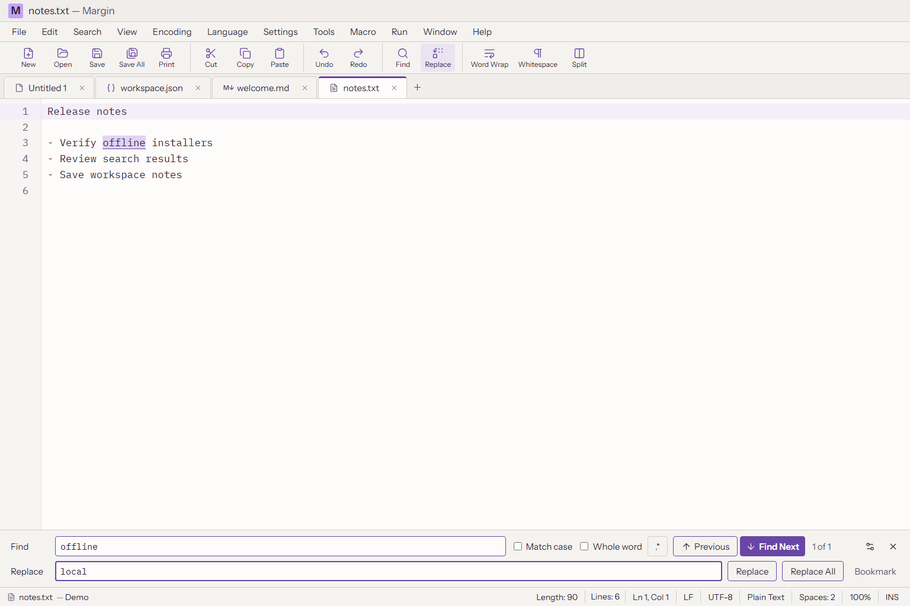

<p align="center"></p>

# Margin

**Plain text for notes, lists, logs, and everything you paste in between.**

Open Margin and start typing. The menu, toolbar, and document tabs keep common actions close, while the status bar shows the current encoding and line endings. When a quick edit turns into a batch change, review the result before writing anything to disk. Your files stay local on Windows, macOS, and Linux.

[Download from GitHub Releases](https://github.com/peterwangze/margin-editor/releases) · [Product research](docs/research.md) · [Release acceptance checklist](docs/acceptance.md)



## Edit and check your text

- **Write a note or tidy a list.** Start in a blank document, drag in files, or split the view to read two places at once. Sort lines, remove duplicates, and use rectangular selections or multiple cursors for repeated edits.
- **Inspect text copied from elsewhere.** Open **Edit → Inspect & clean text** or click the length in the status bar. Count words and graphemes in the document, selection, or loaded page. Choose whether to trim trailing spaces and tabs, convert nonbreaking spaces, or remove zero-width spaces. Preview up to six changed lines and undo the cleanup in one step.
- **Keep file formats under your control.** Reopen with a different encoding or explicitly convert on save. Reopening a Unicode file keeps its byte-order mark (BOM) setting. See line endings in the status bar and choose when to standardize a mixed file. Use **Save a copy** to write to a separate file.
- **Pick up an interrupted edit.** Compare external disk changes before saving. Session recovery restores the last completed local snapshot. With recovery turned off, quitting with unsaved changes offers **Save All**, **Discard Changes**, and **Cancel**.
- **Preview changes across a folder.** Find literal text, escapes, or Boost.Regex patterns. Filter by filename pattern and depth, see before and after, and choose the files to change. Margin checks that the disk files still match the preview before applying it.
- **Find a line in a large log.** Search across pages with literal text or escapes, jump to the result, and edit the loaded page. Saving a page preserves bytes outside it in supported encodings.



*Inspect the selected text, see what the cleanup changes, and keep editing before you save.*



## Install offline

Open the release and choose the asset for your system and processor. The release also includes `SHA256SUMS.txt` to verify your download. [Releases and offline downloads](https://github.com/peterwangze/margin-editor/releases) · [Earlier 0.9.1 packages](https://github.com/peterwangze/margin-editor/releases/tag/v0.9.1)

| Platform | Intel or AMD 64-bit | ARM64 | How to start |
| --- | --- | --- | --- |
| Windows | `win-x64-setup.exe`, `win-x64-portable.exe` | `win-arm64-setup.exe`, `win-arm64-portable.exe` | Run Setup or launch the portable EXE. |
| macOS | `mac-x64.dmg`, `mac-x64.zip` | `mac-arm64.dmg`, `mac-arm64.zip` | Open the DMG or unzip the ZIP, then copy `Margin.app` into Applications. |
| Linux | `linux-x86_64.AppImage`, `linux-amd64.deb` | `linux-arm64.AppImage`, `linux-arm64.deb` | Make the AppImage executable or install the DEB with your package manager. With no FUSE, use `--appimage-extract-and-run`. |

The packages include the application runtime. Linux uses the system's desktop libraries. See the release notes for platform-specific signing and installation details.

## Keyboard shortcuts

| Action | Windows / Linux | macOS |
| --- | --- | --- |
| Open file | Ctrl+O | ⌘O |
| Save | Ctrl+S | ⌘S |
| Find / Replace | Ctrl+F / Ctrl+H | ⌘F / ⌘H |
| Find in Files | Ctrl+Shift+F | ⌘⇧F |
| Go to line | Ctrl+G | ⌘G |
| Split editor | Ctrl+\ | ⌘\ |
| Find a command | Ctrl+Shift+P | ⌘⇧P |

## Compatibility

Margin imports common Notepad++ session details, settings, menu shortcuts, project trees, and part of the user-defined language format. Native Notepad++ plugins and original macro files require Notepad++. Large-file regular expressions work within the loaded page. [Product scope and limits](docs/research.md) · [Release acceptance checklist](docs/acceptance.md) · [Architecture](docs/architecture.md)

## Develop locally

```sh
npm ci
npm run build
npm start
npm test
npx playwright install chromium
npm run test:ui
npm run test:desktop
```

Build offline packages on the target operating system with `npm run package`. On a headless Linux runner, run the desktop tests under `xvfb-run -a`.

[MIT License](LICENSE)
